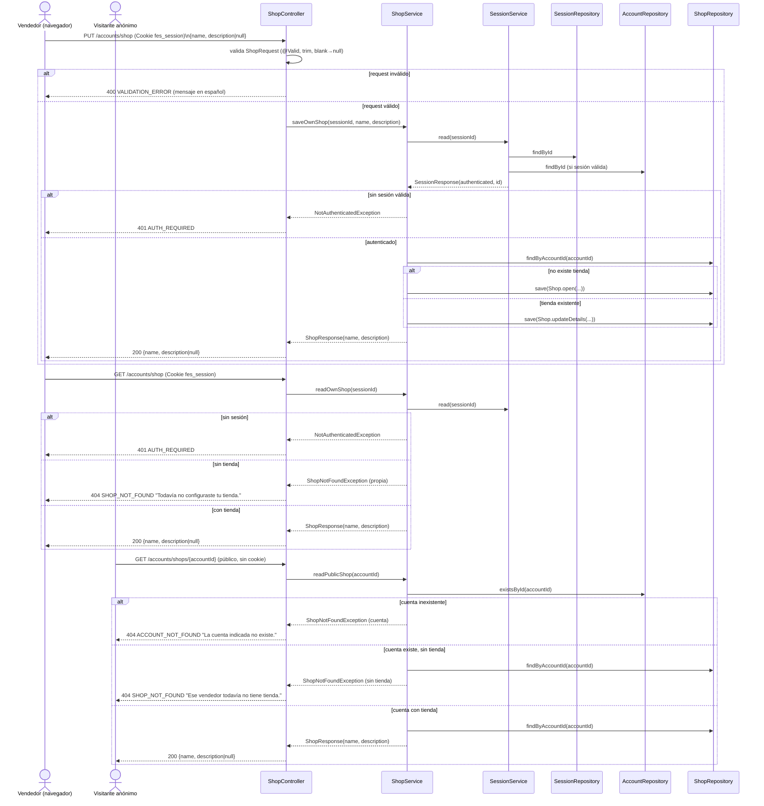
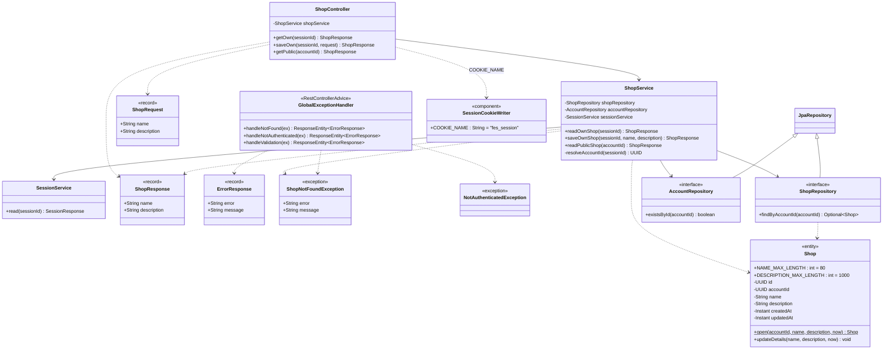

# UML 002 — Tienda pública del vendedor

Diagramas del diseño descrito en `plan.md` / `tasks.md` para `account-api`, en la rama `002/feat-account-shop`. La organización es **Layered** (`controller` / `service` / `repository` / `model` (+ `model/dto`) / `config` / `exception`) con extensiones ya existentes `http/cookie` donde se reutiliza `SessionCookieWriter`. El dominio Shop se aísla por nombres de clase (`Shop*`) sin crear paquetes por capacidad.

## Flujo: guardar y consultar la tienda

El vendedor guarda su tienda con `PUT /accounts/shop` enviando la cookie `fes_session`; el servicio resuelve la cuenta con `SessionService` y hace upsert en `shops`. Un visitante anónimo consulta `GET /accounts/shops/{accountId}` sin cookie. `GET /accounts/shop` devuelve la tienda de la cuenta autenticada. La respuesta pública solo contiene `name` y `description` (nunca `email`).

## Estructura de clases

Clases previstas del paquete `com.friendlyeshop.account` para este corte. Se muestran las relaciones arquitectónicas relevantes (colaboradores, repositorios y contratos públicos) y se omiten dependencias transitivas ya explicadas por un colaborador principal.

## Notas de contrato

- **Prefijo**: `ApiPathConfig` publica todo `controller/` bajo `/accounts`; el controlador solo declara `/shop` y `/shops/{accountId}`.
- **Sesión**: cookie `fes_session` (HttpOnly, SameSite=Lax, Path=/) resuelta con `SessionService.read`; no se inventa autenticación y no se modifica CORS ni `ApiPathConfig`.
- **Guardado (upsert)**: `PUT /accounts/shop` → `200 {name, description|null}`; crea si no existe y reemplaza si existe; una sola fila por cuenta (`UNIQUE (account_id)`).
- **Consulta propia**: `GET /accounts/shop` → `200 {name, description|null}` o `404` si aún no hay tienda; `401` sin sesión.
- **Consulta pública**: `GET /accounts/shops/{accountId}` sin sesión → `200 {name, description|null}` o `404` (cuenta inexistente vs vendedor sin tienda, con mensajes distintos).
- **Privacidad**: `ShopResponse` expone solo `name` y `description`; nunca `email` ni credenciales. `description` se serializa como `null` cuando está ausente.
- **Validación**: `name` obligatorio `1..80` tras recorte; `description` opcional `<=1000` tras recorte y vacía/solo espacios → `null`; `400 VALIDATION_ERROR` con mensaje en español.
- **Persistencia**: migración `V3__create_shops.sql` (`id`, `account_id`, `name`, `description`, `created_at`, `updated_at`) compatible con `ddl-auto: validate`.
